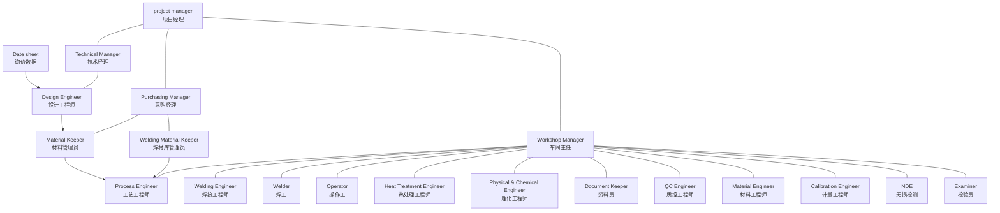

# ООО «БОС»

**ИНН** 3257051161 | **КПП** 325701001  
241013, Брянская область, г. Брянск, ул. Литейная, дом 36А, офис 702  
+7 4832 40-00-49 | bos-cert.ru | info@bos-cert.ru  

**Брянский орган по сертификации**

## АКТ № 12238-12241/АП
**От** [Дата]

### О РЕЗУЛЬТАТАХ АНАЛИЗА СОСТОЯНИЯ ПРОИЗВОДСТВА

**Наименование заявителя / Name of a declarant:**  
Индивидуальный предприниматель Кузнецов Василий Михайлович  

**Юридический адрес/ адрес места осуществления деятельности / Legal address/location of the organization's activities:**  
Место нахождение (адрес юридического лица) и адрес места осуществления деятельности: 109386, Россия, город Москва, улица Новороссийская, дом 5, корпус 2, квартира 111  

**Наименование предприятия-изготовителя / Name of an enterprise-producer:**  
[Заполняется]  

**Юридический адрес / Legal address:**  
[Заполняется]  

**Адрес(а) места осуществления деятельности по изготовлению продукции / Manufacturing site of the company (address):**  
[Заполняется]  

**Основание проверки / Control basis:**  
Заявка № ??? от ???  

**Период проведения проверки / Period of control conduct:**  
С ??? по ??? / from [Date] till [Date]  

**Место проверки (адрес) / Address:**  
[Заполняется]  

**Цель анализа / Aim of the analysis:**  
Наличие необходимых условий для обеспечения стабильного соответствия серийно выпускаемой продукции / Presence of necessary conditions for stable production of serial produced goods:  
*наименование серийно выпускаемой продукции / name of serial produced goods*  
**ТР ТС 012/2011** (обозначение ТР) требованиям технического (их) регламента (ов) / with the requirements of the technical regulations(s)  

**Участники проведения анализа состояния производства / Participants of conducting analysis of production conditions:**

| Ф.И.О. / Surname, name | Занимаемая должность / Position held |
| :--- | :--- |
| Галеулин Д.Г. | Эксперт по сертификации |
| Кузнецова В.А. | Эксперт по сертификации |
| Симакова М.С. | Стажер |

**Представитель предприятия-изготовителя / Representative of an enterprise-producer:**

| Ф.И.О. / Surname, name | Занимаемая должность / Position held |
| :--- | :--- |
| [Ф.И.О.] | [Должность] |

**База анализа / Analysis base:**  
Программа проведения анализа состояния производства № 12238-12241/ПП от 22.04.2025, ГОСТ Р 54293-2020 «Анализ состояния производства при подтверждении соответствия продукции»  

**Дополнительные материалы, используемые при анализе состояния производства / Additional materials, used while analyzing the production conditions:**  
[Заполняется]  

---

### РЕЗУЛЬТАТЫ ПРОВЕРКИ / RESULTS OF CONTROL:

#### 1. Общая информация о предприятии-изготовителе серийно выпускаемой продукции / General information about an enterprise-producer of serial produced goods (企业一般信息)

| Параметр / Parameter | Значение / Value |
| :--- | :--- |
| **Дата ввода в эксплуатацию** Date of putting into operation (企业创立时间/营业执照) | 2002.9.13 |
| **Общая площадь предприятия** Total area of an enterprise (企业总面积) | 36300m² |
| **Площадь производственных помещений** Square of manufacturing facilities (生产设施面积) | 21000m² |
| **Общая численность работников, задействованных при выпуске серийно выпускаемой продукции** Total number personnel, enabled into an output of serial produced goods (总员工总数/交社保的所有人数) | 134 |
| **Сертификат о соответствии ISO 9001, ISO 50001, ISO 14001, 18001** (при наличии указать выдавший орган, номер и дату выдачи) Certificate of compliance (ISO证书出具机构的英文名称、证书编号和截止日期) | ISO9001:2015 Certificate NO: 9722500651R0M valid until: 2028-12-09 ISO14001:2015 Certificate NO: 97225E0601R0M valid until: 2028-12-09 ISO45001:2018 Certificate NO: 9722550596R0M valid until: 2028-12-09 |

---

#### 2. Документация / Documentation

| № п/п | Объект проверки / Object of Control | Оценка объекта проверки / Estimation of the object of control |
| :--- | :--- | :--- |
| **2.1** | **Наличие и полнота необходимой нормативной и технической документации на продукцию и методы ее испытаний** Presence of necessary normative and technical documentation for the goods and methods of its tests *(有关于货物及其测试方法的必要规范和技术文件)* | (Нормативная, конструкторская, технологическая документация, документы системы качества) *(法规、设计、技术文件、质量体系文件)* **ASME Sec. VIII, Div.1 2023 Edition** |
| **2.2** | **Наличие документации, устанавливающей требования к внесению изменений в документацию (конструкторскую, технологическую, регистрационно-учетную)** Presence of documentation, that establishes the requirements for amendments to the documentation (design, technological, registration and accounting) *(含有对文件[设计、技术、注册和会计]进行修改的要求的文件)* | (наименование и обозначение документированной процедуры или журнала) *(记录程序或日志的名称和编号)* **Quality control manual section No.2.0 contract review and control of Design** |
| **2.3** | **Лицо, ответственное за состояние и актуализацию нормативной и технической документации** Person, responsible for the condition and actualization of normative and technical documentation | **Tang Xiaofeng Designer** *(Ф.И.О., должность / surname, name, position)* |
| **2.4** | **Обеспеченность и доступность использования актуализированной документации на рабочих местах** Availability and availability of updated documentation in the workplace *(租赁合同/不动产证明)* | Договор на обеспечение актуальной нормативной документацией с ООО № от *(提供最新规范性文件的合同)* **厂房不动产编号0297921 使用日期到2060-7-29** |

---

#### 3. Персонал / Personnel

| № п/п | Объект проверки / Object of Control | Оценка объекта проверки / Estimation of the object of control |
| :--- | :--- | :--- |
| **3.1** | **Наличие должностных инструкций персонала и соответствие квалификации персонала их требованиям, наличие допуска к проведению работ, повышение квалификации и аттестация персонала** Presence of job descriptions of personnel and correspondence of personnel qualification to their demands, presence of permission to work conduct, raising the level of personnel skill and attestation of personnel *(员工岗位说明书，员工资质[无损检测人员资质和焊工证]，员工继续教育和考核程序文件)* | Персонал, влияющий на соответствие выпускаемой продукции, имеет должностные инструкции и соответствующую квалификацию. Порядок (или правила) повышения квалификации, аттестации, допуска к работам, разработки должностных инструкций установлено в `<обозначение документа>` *(影响所生产产品合格性的人员都有岗位说明和相关资格证书。资格提高、认证、上岗、制定工作说明的程序[或规则]见<文件名称>)*  Удостоверения о повышении квалификации `<рег №№, дата>` Протоколы аттестации `<№, дата>` Удостоверения специалистов `<область>` `<№, дата, срок действия>` *(相应技能证书[编号,日期] 见附件)* |

---

#### 4. Инфраструктура и оборудование (средства технологического оснащения) / Infrastructure and equipment (means of technological equipment)

| № п/п | Объект проверки / Object of Control | Оценка объекта проверки / Estimation of the object of control |
| :--- | :--- | :--- |
| **4.1** | **Наличие необходимых элементов инфраструктуры, обеспечивающих выполнение в процессе производства обязательных требований к изготавливаемой продукции (территория, производственные площади, транспорт и т.п.)** Presence of the necessary elements of infrastructure, providing performance in the manufacturing process of mandatory requirements for manufactured products (land, production areas, transportation, etc.) *(具备必要的基础设施要素，在生产过程中满足制成品的强制性要求[土地、生产区、运输等])* | **厂房不动产编号0297921 使用日期到2060-7-29** |
| **4.2** | **Наличие необходимого производственного оборудования и его состояние** Presence of necessary production equipment and its condition *(证明必要生产设备及其可用性)* | имеет необходимое оборудование соответствующее требованиям, установленным в технологической документации. В эксплуатации находится более [N] единиц оборудования. (Выборочная если более 10 единиц) Проверка подтвердила его работоспособность. *(拥有必要的设备符合技术文件中规定的要求。有超过件设备在运行。[选择性—如果有超过10个单位]检查确认其可操作性。)* **见附件3** |
| **4.3** | **Наличие документации, устанавливающей требования для поддержания в рабочем состоянии инфраструктуры и технологического оборудования** Presence of documentation that establishes the requirements for maintenance of the infrastructure and process equipment in working condition *(提供证明维护基础设施和技术设备正常工作的要求的文件)* | (наименование и обозначение документа) *(文件名称及编号)* **此处请提供生产设备检定证** |
| **4.4** | **Наличие документации по техническому обслуживанию и предупредительного ремонта оборудования** Presence of documentation of technical servicing and preventive repair of the equipment *(用于设备维护和预防性维修的文件)* | (документированная процедура и/ или План-график(и) на год) *(年的文件程序及/或时间表)* **见附件** |
| **4.5** | **Ответственные лица за контроль оборудования** Responsible persons for control of the equipment *(设备检测负责人)* | **Xu mingfeng Electrician** *(Ф.И.О., должность / surname, name, position)* |

---

#### 5. Средства измерений и управление контрольным, измерительным и испытательным оборудованием / Measuring instruments and control of control, measuring and testing equipment

| № п/п | Объект проверки / Object of Control | Оценка объекта проверки / Estimation of the object of control |
| :--- | :--- | :--- |
| **5.1** | **Наличие необходимых средств измерений и их состояние** Presence of necessary measuring instruments and its condition *(所需计量器具的可用性及其状况)* | В наличии имеются все средства измерений, необходимые для контроля характеристик выпускаемой продукции, с действующей поверкой калибровкой. Условия хранения и содержания соответствуют установленным требованиям. *(可提供控制产品特性所需的所有测量仪器，并提供有效的验证/校准。储存和维护条件符合既定要求。)* **此处请提供计量器具台账** |
| **5.2** | **Подразделение или лицо, ответственное за метрологическое обеспечение производства** Subdivision or a person responsible for metrological provision of the production *(负责生产计量支持的单位或人员)* | **Pu mingfeng CEC** *(наименование подразделения, Ф.И.О. / name of a subdivision, surname, name)* **无锡计量局** |
| **5.3** | **Сторонние организации, привлекаемые для проведения метрологических работ** Exterior organizations, attracted for metrological works | (наименование организации / name of an organization) **没有合同,直接拿去,只填单子** |
| **5.4** | **Наличие графиков проведения поверки/калибровки контрольно-измерительных приборов** Presence of control conduct schedules/calibration schedules of control-measuring devices *(计量器具的验证/校准时间表)* | **此处请提供计量器具校准保养计划/流程** *(压力表计量周期是半年，其他仪器一年周期)* |
| **5.5** | **Документы, подтверждающие выполнение графика поверки/калибровки (свидетельства, клейма, аттестаты)** Documents confirming execution of the control schedule/calibration schedule (certificates, stamps, etc.) *(确认满足验证/校准计划的文件[证明、印章、证书等])* | **此处请提供计量器具的检定证书 (不少于5份)** **见附件** |

---

#### 6. Входной контроль сырья и материалов / Entrance control of raw and materials

| № п/п | Объект проверки / Object of Control | Оценка объекта проверки / Estimation of the object of control |
| :--- | :--- | :--- |
| **6.1** | **Формы проведения входного контроля** Forms of conducting entrance control *(入场检验的形式)* | - **Испытания / Tests** - **Визуальный / Visual** - **Предоставление поставщиком данных по испытаниям продукции** / Giving data on goods tests by a supplier - **Предоставление поставщиком сертификатов на продукцию, материалы** / Giving certificates for the goods, materials by a supplier |
| **6.2** | **Наличие документации, устанавливающей требования к проведению входного контроля (сырья, материалов, комплектующих изделий)** Presence of documentation, that establishes the requirements for entrance control (raw materials, components) *(提供确定入场检验要求的文件[原材料、材料、组件])* | (наименование и обозначение документа / 文件名称及编号) *(此处请提供质量手册中入场检验程序、原材料、部件入场复验规定的编号和文件全名并提供对应文件)* **Quality control manual section No. 3.0 purchasing and material control** |
| **6.3** | **Наличие на предприятии условий для хранения сырья и материалов** Presence of conditions at the enterprise for raw and materials storage *(企业原材料和材料储存条件的可用性)* | Сырье и материалы хранятся в открытом и (или) крытом складском помещении/ специально отведенном оборудованном месте на стеллажах и т.п. в соответствии с требованиями обозначение и наименование процедуры «Входной контроль» / «Инструкция по хранению готовой продукции, сырья и материалов» и т.п. *(原材料和用品存放在开放和[或]有盖的仓库/特别指定的配备场所/货架上等。按照要求<指定和程序的名称—"进料控制"/"成品,原材料等储存说明">)* |
| **6.4** | **Наличие журналов по регистрации поступающего сырья и вспомогательных материалов** Presence of journals on registration of entering raw and addition materials *(用于进料和辅料登记的日志)* | **此处请提供材料接收检验及标志转移记录文件** **Quality procedure document ZC/QP01-2010 Material coded marking and transfer procedure** |
| **6.5** | **Наличие идентификации статуса проконтролированной продукции и способов защиты от передачи в производство несоответствующей входной продукции** Presence of controlled products status identification and ways to prevent the usage of nonconforming incoming products in the production process *(是否对已检验产品的状态进行了标识，以及采取了哪些措施防止不符合要求的进料进入生产环节)* | **该部分工作专家到车间查看** |

---

#### 7. Технологические процессы, в том числе специальные / Technological processes, including special

| № п/п | Объект проверки / Object of Control | Оценка объекта проверки / Estimation of the object of control |
| :--- | :--- | :--- |
| **7.1** | **Наличие технологических инструкций на производство продукции** Presence of technological instructions for goods production *(产品生产技术说明的可用性)* | 手册中对应章节的内容文件编号和名称并提供对应文件 **已提供,请再次放入对应文件夹** |
| **7.2** | **Технологическая схема производства продукции** Technological scheme of goods production *(工艺流程图)* | *(如下图流程图结构所示)* |
| **7.3** | **Выполнение валидации специальных процессов (операций), связанных с формированием характеристик продукции, для которых установлены обязательные требования** Performance of the validation of special processes (operations) related to the formation of the product characteristics, for which mandatory requirements are set *(对与形成产品特性有关的特殊过程[操作]进行验证，对这些特殊过程[操作]制定了强制性要求)* | **请提供对应文件** |

##### 7.2 结构图 (Organizational / Technological Process Structure)

---

#### 8. Приемочный контроль и периодические испытания / Acceptance control and periodic testing

| № п/п | Объект проверки / Object of Control | Оценка объекта проверки / Estimation of the object of control |
| :--- | :--- | :--- |
| **8.1** | **Лицо или подразделение, ответственное за качество серийно выпускаемой продукции** Person or subdivision responsible for the quality of serial produced goods *(负责产品质量的人员或部门)* | **Chen zhengming CQE** *(Ф.И.О., должность / surname, name, position)* |
| **8.2** | **Наличие испытательной лаборатории и ее обеспеченность необходимым испытательным оборудованием и поверенными средствами измерений** Presence of testing laboratory and its provision with necessary testing equipment and checked measuring means *(有检测实验室，并配备必要的检测设备和经过验证的测量仪器)* | **该部分工作专家现场查看** |
| **8.3** | **Наличие договоров со сторонними лабораториям на проведение испытаний** Presence of contracts with side laboratories for tests conduct *(与第三方实验室签订测试合同的情况)* | **Jiangsu Rongda Material corrosion inspection Co., Ltd.** *(наименование испытательной лаборатории, номер договора)* |
| **8.4** | **Наличие утвержденных методик контроля и испытаний** Presence of approved methods of control and testing *(是否有经批准的控制和检测方法)* | **请提供ITP** |
| **8.5** | **Наличие плана контроля** Presence of the plan of control *(控制计划)* | **请提供ITP** |
| **8.6** | **Наличие и ведение документации учета, регистрации и хранения результатов испытаний** Presence and conduct of calculation, registration and tests results storage documentation *(提供并维护用于记录、登记和存储测试结果的文件)* | **Chen Zhengming CQE** *(должность ответственного за хранение / position of the responsible person for keeping)* |
| **8.7** | **Срок хранения документов по учету, регистрации результатов испытаний** Period of keeping documents on calculation, registration of tests results *(会计文件、测试结果登记文件的保存期限)* | 此处请输入期限，比如3年 **测试文件 按设备的使用年限来存储** |
| **8.8** | **Наличие удостоверений или сертификатов аттестации специалистов** Presence of certificates of specialists attestation *(专业人员证书)* | **此处同3.1** |

---

#### 9. Идентификация продукции и ее прослеживаемость / Product identification and traceability

| № п/п | Объект проверки / Object of Control | Оценка объекта проверки / Estimation of the object of control |
| :--- | :--- | :--- |
| **9.1** | **Наличие системы идентификации продукции, обеспечивающая прослеживаемость от склада поступающих материалов до выхода готовой продукции** Presence of a product identification system that provides traceability from the warehouse of incoming materials to the output of finished products *(建立产品识别系统，确保从进料仓库到成品产出的可追溯性)* | (наименование и обозначение документа) *(此处请输入标识和可追溯性管理程序，材料接受检验以及标志转移记录，质量手册中对应文件编号及名称并提供对应文件)* **Quality procedure document ZC/QP01-2010 Material coded marking and transfer procedure** |
| **9.2** | **Соблюдение требований к погрузочно-разгрузочным работам, хранению и складированию продукции** Observance of the demands to loading-unloading works, storage and package of goods *(遵守产品装卸、储存和仓储要求)* | 文件 此处请提供... |

---

#### 10. Маркировка готовой продукции, условия её хранения, упаковка и консервация / Marking, storage, packaging and preservation of products

| № п/п | Объект проверки / Object of Control | Оценка объекта проверки / Estimation of the object of control |
| :--- | :--- | :--- |
| **10.1** | **Соответствие маркировки готовой продукции и упаковки требованиям нормативной документации** Correspondence of marking and packing to the demands of normative documentation *(成品的标记及包装是否符合监管文件的要求)* | **此处请提供产品验收和包装要求说明文件** **按图纸技术要求执行** |
| **10.2** | **Соответствие условий хранения и консервации готовой продукции требованиям нормативно-эксплуатационной и технической документации** Correspondence of the storage and preservation to the demand of normative documentation *(成品的储存和保存条件是否符合监管文件的要求)* | Соответствует требованиям эксплуатационной и технической документации `<конкретный НД предприятия>` *(企业的特定规范性文件)* **此处请提供产品存储要求说明文件** |

---

#### 11. Взаимодействие с потребителем / Interaction with the consumer

| № п/п | Объект проверки / Object of Control | Оценка объекта проверки / Estimation of the object of control |
| :--- | :--- | :--- |
| **11.1** | **Наличие претензий и рекламаций на сертифицированную продукцию** Presence of claims or reclamations for certified goods *(关于认证产品的索赔和投诉的可用性)* | Указывается в случаях: - повторная сертификация продукции - ик *(在以下情况下指出: - 产品重新认证 - 年审)* |
| **11.2** | **Регистрация претензий и рекламаций, анализ и мероприятия по их устранению** Registration of claims or reclamations, analysis and elimination measures *(索赔和投诉的登记、分析和消除措施)* | Указывается при первичной, повторной сертификации, ИК: На предприятии имеется / представлен Журнал регистрации претензий и рекламаций / Другое *(在初次认证、重新认证、年审时均应注明: 企业已提交 索赔和投诉登记日志 / 其他)* *(此处请输入质量手册中的索赔投诉管理程序文件编号及名称并提供对应文件)* **无** |

---

#### 12. Управление несоответствующей продукцией, корректирующие и предупреждающие мероприятия / Management of non-conforming products, corrective and preventive activities

| № п/п | Объект проверки / Object of Control | Оценка объекта проверки / Estimation of the object of control |
| :--- | :--- | :--- |
| **12.1** | **Наличие документированной процедуры по управлению несоответствующей продукцией** Presence of documentation procedure for managing nonconforming products *(管理不合格品的文件程序)* | (наименование и обозначение документа) *(此处请输入并提供质量手册中的不合格品管理程序文件编号及名称)* **Quality control manual section No.5.0 control of Non-conformities.** |
| **12.2** | **Проверка устранения несоответствий, выявленных по результатам прошлого анализа состояния производства (если имелись)** Verification of the elimination of nonconformities identified by the results of the previous analysis of the state of production (if any) *(对消除上次生产状态分析结果[如有]中发现的不符合项的情况进行核查)* | [Заполняется] |

---

#### 13. Комментарии и рекомендации / Comments and recommendations

| № | Пункт / Item | Статус / Status |
| :--- | :--- | :--- |
| **13.1** | **Несоответствия отсутствуют** / No unsatisfactory findings **Выявлены несоответствия:** / Inconsistencies identified: *(содержание несоответствия (ий) / content)* | [ ] Несоответствия отсутствуют [ ] Выявлены несоответствия |
| **13.2** | **Инфраструктура производства, технологическое и метрологическое оснащение обеспечивает изготовление сертифицируемой/ сертифицированной продукции** Technological and metrological equipment ensures the production of products *(生产基础设施、工艺设备及计量设备确保了可认证/已认证产品的制造)* | [ ] да / yes [ ] нет / no |
| **13.3** | **Кадровый состав персонала, занятого на производстве сертифицируемой/ сертифицированной продукции, обучен, аттестован и выполняет все операции, регламентированные технической документацией** The personnel employed in production are trained, certified and perform all operations regulated by technical documentation *(从事认证中/已认证产品生产的人员均经过培训和考核，并严格执行技术文件中规定的所有操作)* | [ ] да / yes [ ] нет / no |
| **13.4** | **Производство представленной к сертификации/ сертифицированной продукции стабильно** Production is stable *(提交认证/已获认证产品的生产保持稳定)* | [ ] да / yes [ ] нет / no |

**Приложения (при наличии) / Additions:**  
Прикладываем сертификаты на соответствие системы качества (если есть), действующие на момент проведения АСП.

---

### ВЫВОДЫ / CONCLUSIONS:
[Заполняется]

---

### УЧАСТНИКИ ПРОВЕДЕНИЯ АНАЛИЗА СОСТОЯНИЯ ПРОИЗВОДСТВА / PARTICIPANTS OF CONDUCTING ANALYSIS OF PRODUCTION CONDITIONS:

| Ф.И.О. / Surname, name | Занимаемая должность / Position held | Подпись / Signature |
| :--- | :--- | :--- |
| Галеулин Д.Г. | Эксперт по сертификации | |
| Кузнецова В.А. | Эксперт по сертификации | |
| Симакова М.С. | Стажёр | |

### ПРЕДСТАВИТЕЛЬ ПРЕДПРИЯТИЯ-ИЗГОТОВИТЕЛЯ / REPRESENTATIVE OF AN ENTERPRISE-PRODUCER:

| Ф.И.О. / Surname, name | Занимаемая должность / Position held | Подпись / Signature |
| :--- | :--- | :--- |
| [Ф.И.О.] | [Должность] | |

---
*Акт о результатах анализа состояния производства Органа по сертификации продукции ООО «БОС»*  
*Уникальный номер записи в РАЛ: RA.RU.10АМ02*