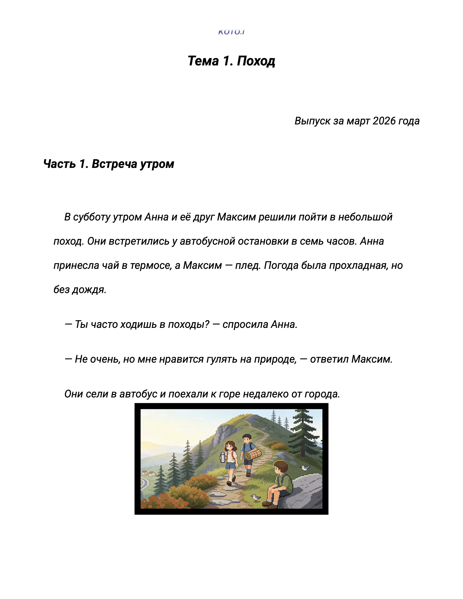
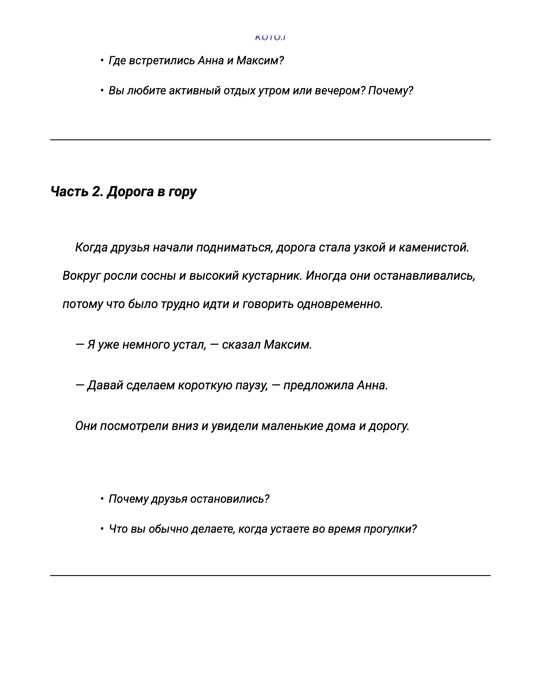
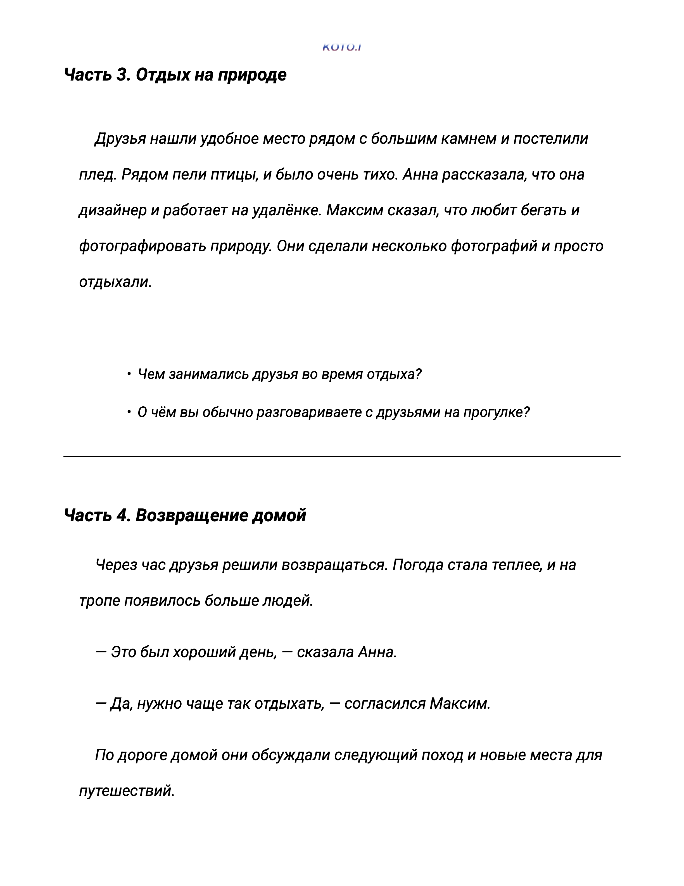
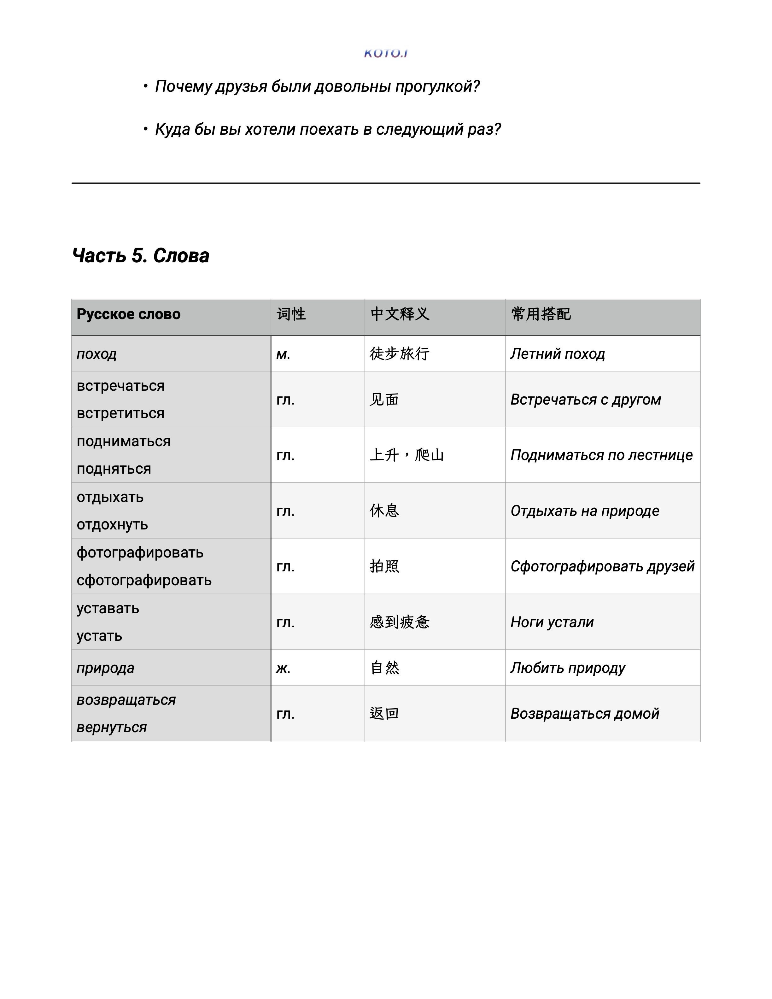
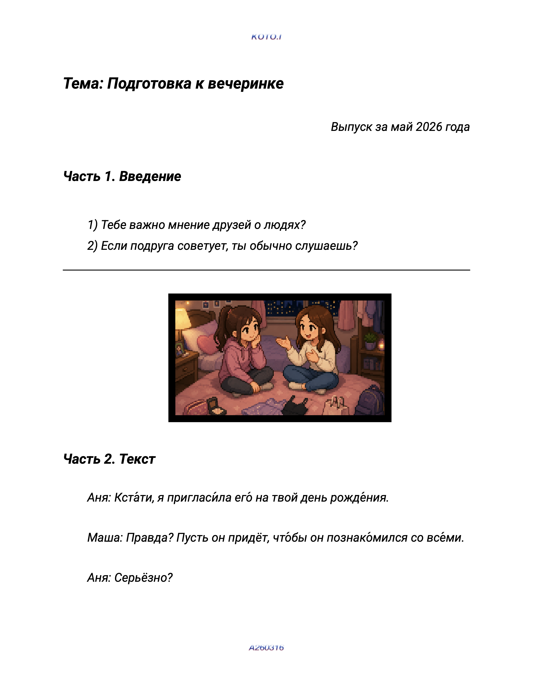
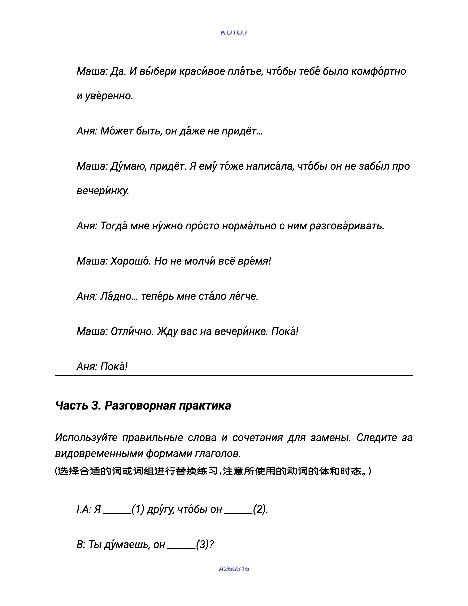

# 一. 课程材料标准演示

## 1. 课件规范

* **会话课范例 1**：  
  
  
  
  

* **会话课范例 2**：  
  
  
  

---

## 2. 字体规范

课件材料与板书笔记通用字体：
* **中文通用字体**：秋水书体
* **俄文通用字体**：Roboto

---

## 3. 板书规范

* **俄文通用字体**：Roboto
* **标题字号**：18
* **正文字号**：14

---

# 二. 授课流程标准

## 1. 课前准备（Before Class）

### 熟悉学生信息
确认以下内容：
* 学生姓名
* 学生水平能力或当前课程进度
* 学生的课程计划
* 上节课学习内容
* 作业完成情况
* 特殊备注（考试、留学、工作需求等）

### 检查课件与教材
确认以下内容：
* 了解本课学习要点和练习重点
* 对于课程如何开展有一定概念
* 本节课课件与教案都正确
* 配套教材准备完成
* 音频、视频等素材可正常播放
* 板书内容提前规划

### 设备检查
线上课程需提前进入教室。检查：
* 网络连接
* 摄像头
* 麦克风
* 屏幕共享
* 文件格式

> **建议**：提前 5 分钟完成所有准备工作。

---

## 2. 课中（In Class）

### 建立连接（5%）
* **目标**：建立课堂氛围，降低学生开口压力。
* **建议**：问候 ➔ 简单寒暄 ➔ 回顾生活 ➔ 随着话题进入本节课主题。

### 回顾旧知（5%-10%）
充分了解材料和学生课程情况，随着课程进行，在交流中观察学生是否能够理解并使用，在学生遗忘时能及时提醒和练习。

### 输入新知（30%）
课程以教材或阅读材料为核心展开。学生首先完成课文朗读，教师重点关注：
* 发音与语调；
* 朗读节奏；
* 重音与停顿；
* 自然表达。

> 对于学生不理解的词汇、表达或句子，教师应及时提供解释，引导学生结合上下文完成理解。

### 理解确认（25%）
教师通过针对课文内容的提问，与学生展开互动。提问重点围绕：
* 是否理解文章内容；
* 是否能够复述信息；
* 是否能够解释重点表达；
* 是否能够回答与课文相关的问题。

> 如课堂中出现上节课学习过的表达方式，教师应观察学生是否能够自然理解和使用，并通过提醒、追问或重复帮助学生完成巩固。  
> **注意**：语言复习应自然融入交流过程，而非脱离语境进行机械回顾。

### 语言输出（20%）
教师应根据课程等级选择不同的输出形式：

* **初级课程**：  
  围绕本课重点表达展开练习。通过替换练习、情景模拟、问答互动等方式，帮助学生理解并能够实际使用新的表达方式。结合教材课后练习及预设任务，引导学生完成语言输出。

* **中高级课程**：  
  以课文主题为基础，与学生展开延伸交流。鼓励学生表达观点、分享经历、提出问题，并在真实交流过程中运用本课、课外词汇与表达。教师应关注表达能力，而非追求语法零错误。

### 课堂总结（5%-10%）
课程结束前，教师应帮助学生梳理本节课重点内容，包括：
* 本课重点词汇；
* 核心表达方式；
* 容易出现的问题；
* 可以尝试使用的新表达。

*(布置任务)*

---

## 3. 课后教学（After Class）

### 课后日常执行
1. **及时发送课堂板书**
2. **更新课堂记录**：
   * 本节课完成内容
   * 学生掌握情况
   * 出现的问题与难点
   * 下节课需要重点关注的内容

### 教学复盘与反馈
课堂观察人员将结合课堂表现，对教学节奏、互动方式、内容安排等进行梳理，并与教师共同讨论优化方案。

### 作业与课后任务
我们不采用统一作业制度。是否布置作业、作业形式及完成要求，将结合学生学习目标、学习习惯、课余时间及课程进度，由教师与教研负责人共同决定。

### 课程动态调整
教师应根据学生学习进度、课堂表现及反馈情况，及时提出调整建议。通过持续记录、持续沟通、持续优化，为学生提供更加符合个人需求的学习方案。