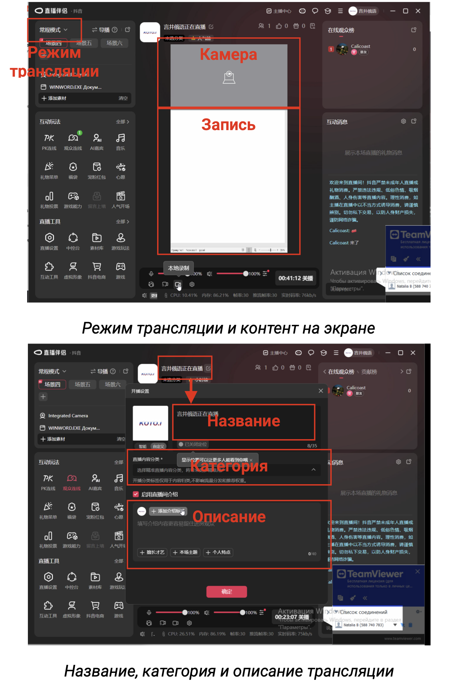
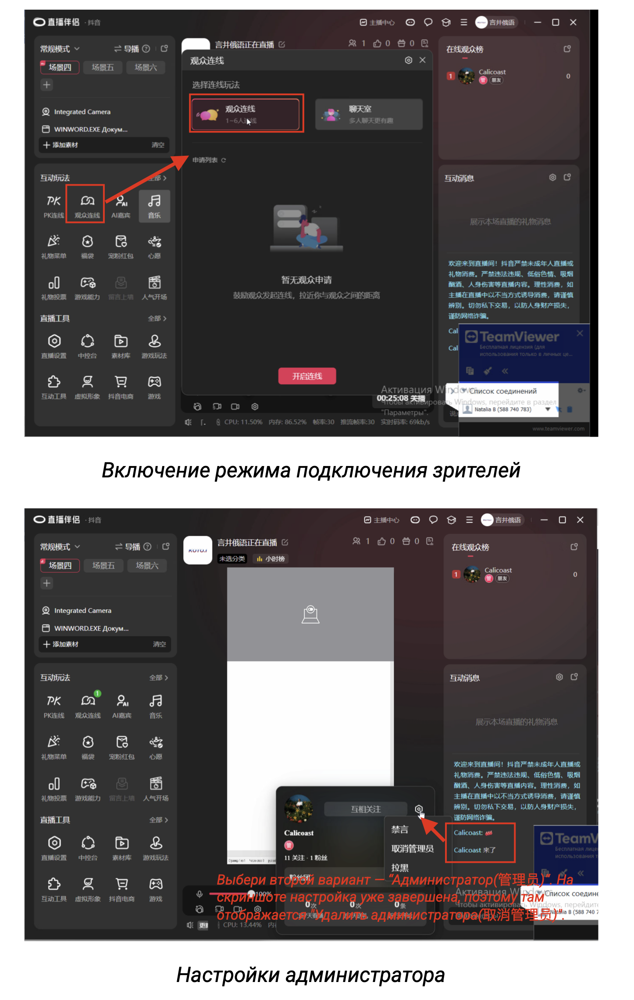
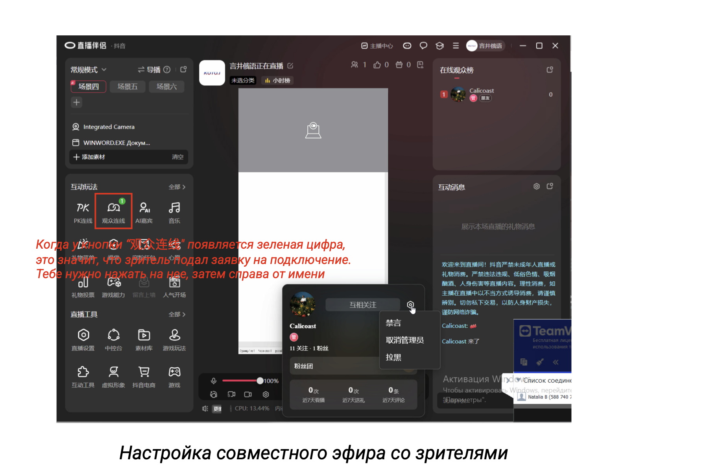
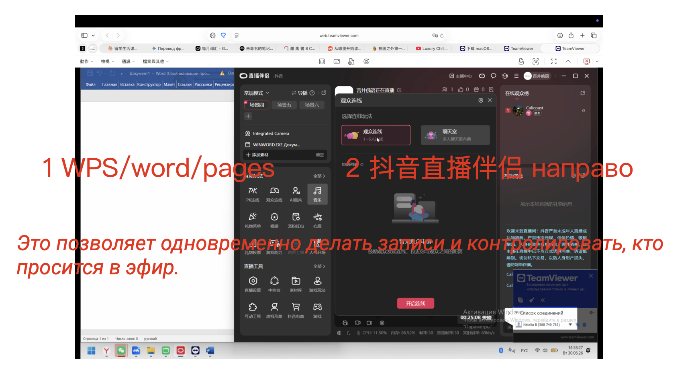
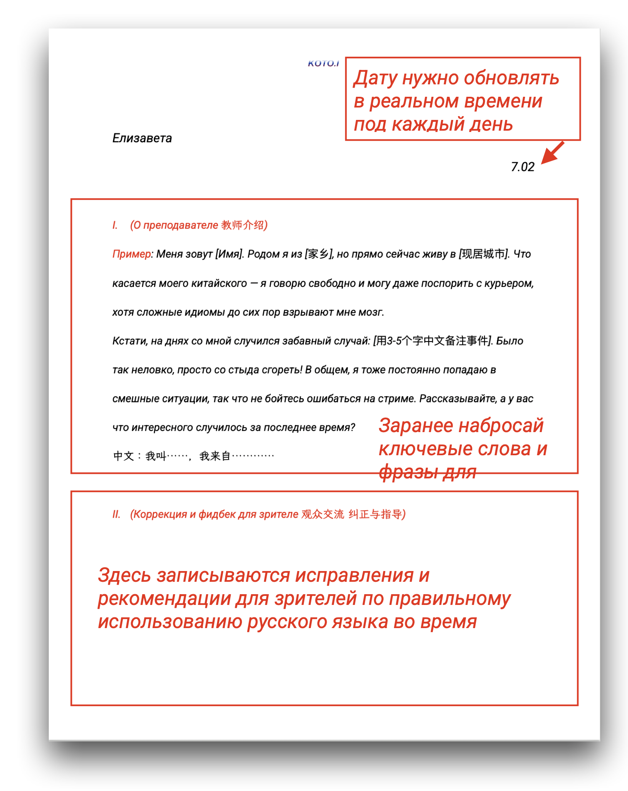
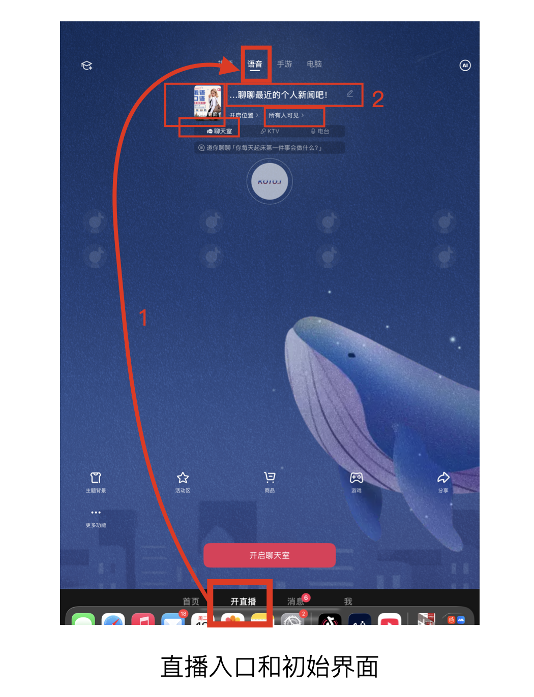
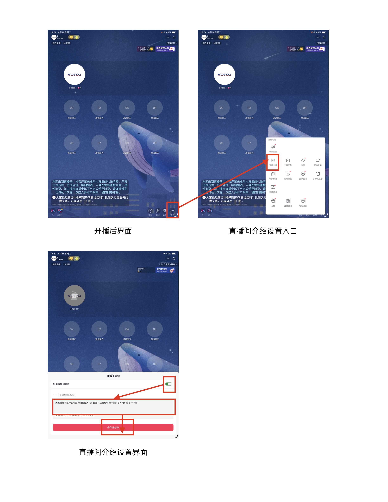
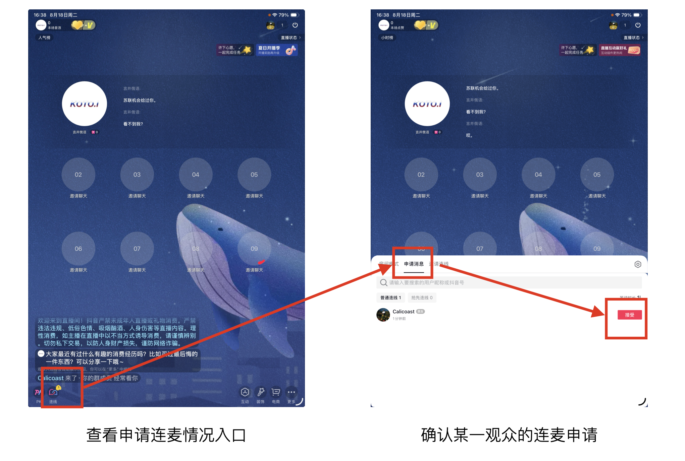
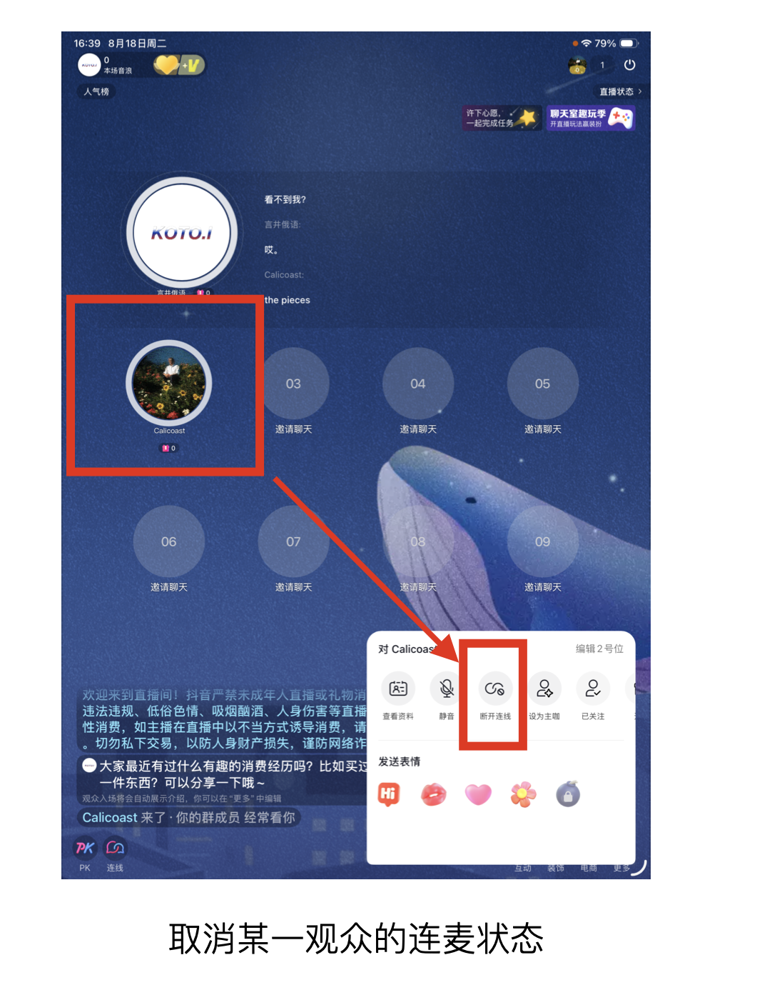

# 抖音直播准备和注意事项

## 一. 电脑端直播

### 1. 开播前

每次开播前 1 小时需要我远程操作去调试“抖音直播伴侣”的设置，设置内容包括直播模式、直播页面展示内容（笔记文档的默认设置和摄像头的调试）、直播页面展示账号信息（如直播间名称、直播间公告等设置）。

除此之外，教师需要提前准备双语自我介绍，自我介绍可以把关键词和句子提前写在笔记中，以及准备开场破冰的话题。

---

### 2. 开播后

首先观众连线只有在开播后才可以设置，因此需要在开播后由老师本人操作设置“观众连线”模式，然后将用户“Calicoast（我的小号）”设置成管理员。

请确认板书文档页和直播助手同时在前台运行。如果你切换到浏览器的其他标签页，直播间的演示画面就会变成黑屏。

在交流过程中帮观众纠正俄语用法、教学观众其不会的俄语表达时，可以将关键词或关键句写在笔记文档上。文档的第一部分从始至终保留，作为展示页面。为观众书写的笔记写在第二部分，每次新观众上麦后可以把第二部分的笔记删除，在原位置书写新笔记。因为滚动页面会使后来的观众看不到你的个人介绍，每次与一位观众交流完，清除该部分笔记内容，就可以返回首页，观众就看得到你的个人信息。

---

### 3. 直播流程

1. 双语自我介绍，聊今天简单的日常（6-8min），邀请观众上麦
2. 观众 1 上麦（5-10min） / 口播广告
3. 话题延伸 / 评论区互动 / 邀请上麦（5min）
4. 观众 2 上麦（5-10min） / 口播广告 / 邀请上麦
5. 话题延伸 / 评论区互动（5min）
6. 观众 3 上麦（5-10min） / 邀请上麦
7. 观众 4 上麦（5-10min） / 口播广告……
8. 总结，口播广告，表达感谢

> **口播内容**：如果你想练口语，可以 DM 我，我们可以现在有一对一 30 分钟口语会话的活动，一杯奶茶即可拿下。

我给的直播流程不是一个精确的流程，因为我们没法控制上麦的观众的数量和频次。所以这个结构是由固定流程——自我介绍、话题自述，然后是从开播第 15 分钟左右开始口播广告，平均一整场直播 3-4 次口播广告，每 10-15 分钟 1 次（口播内容如上）。

然后每次到话题空档，没有人上麦的时间段时，我们先发出邀请：
> *"Есть желающие созвониться? Ничего страшного, если получается пока не очень, и если вы только начали учить — тоже ничего. Это отличный шанс попрактиковаться, мы можем говорить помедленнее."*  
> （有人想要上麦吗？说不好也没关系，刚开始学俄语也没关系，这是个练习的好机会，我们可以慢点说）

然后稍等一会儿看是否有申请者，如果没有可以回应一下评论区问题、根据直播主题找另外的话题延展方向，或是接着前一个观众的话题继续表达等等。表述过程中，关注是否有申请者，如有就可以允许他上麦即可开始交流。如一直没有观众申请连麦，大约维持 5 分钟讲一次邀请词的频率就好。

助手会在主播和观众进行交流的时候去搜集评论区的中文互动消息，然后整理好在空档时发给主播，主播可以一一进行回应。

最后 10 分钟时，如还有人正在连麦，而申请列表还有人在排队，可以在结束当前对话时，说明“我们马上要结束了，还可以连最后一次”。以上流程直播助手会实时监测，并且会通过微信给主播指令推进流程，因此主播有条件最好另开一个设备登录微信，实时查看指令消息。

---

## 二. 移动设备端语音直播

### 1. 开播前

1. 进入直播界面后确认直播模式为“语音”模式。
2. 需要根据要求设置直播封面和标题；正式播出时应当选择“所有人可见”范围 + “聊天室”模式。

---

### 2. 开播后

首先根据当日直播主题设置“直播介绍”内容，并保存修改。

查看是否有观众申请连麦，了解如何确认观众连麦和解除连麦的操作步骤：

1. **确认连麦**：当有观众连麦时，图示位置就会出现数字，点开确认连接即可。  
   

2. **解除连麦**：当结束和一个观众连麦时，点击对应位置的观众头像，断开连接。  
   
