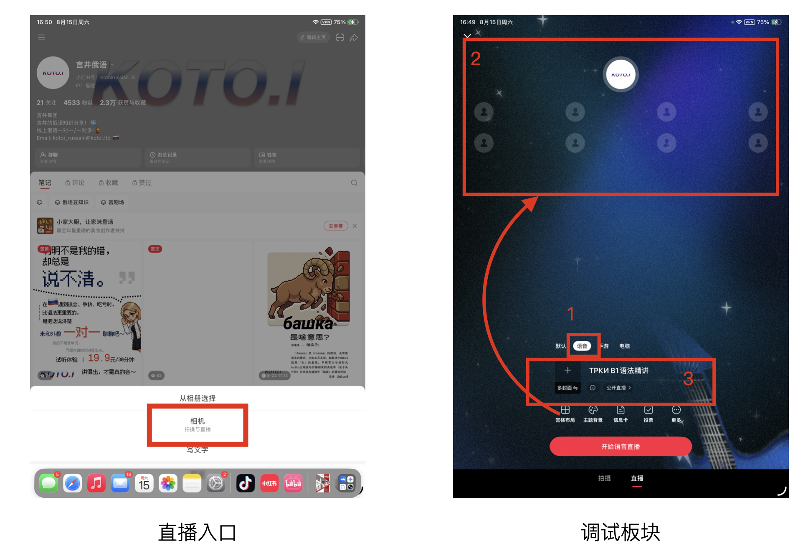
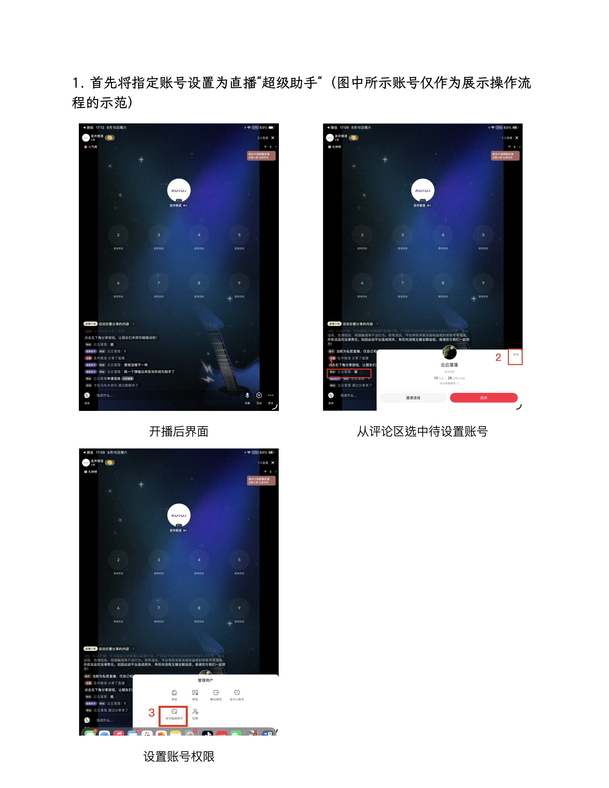
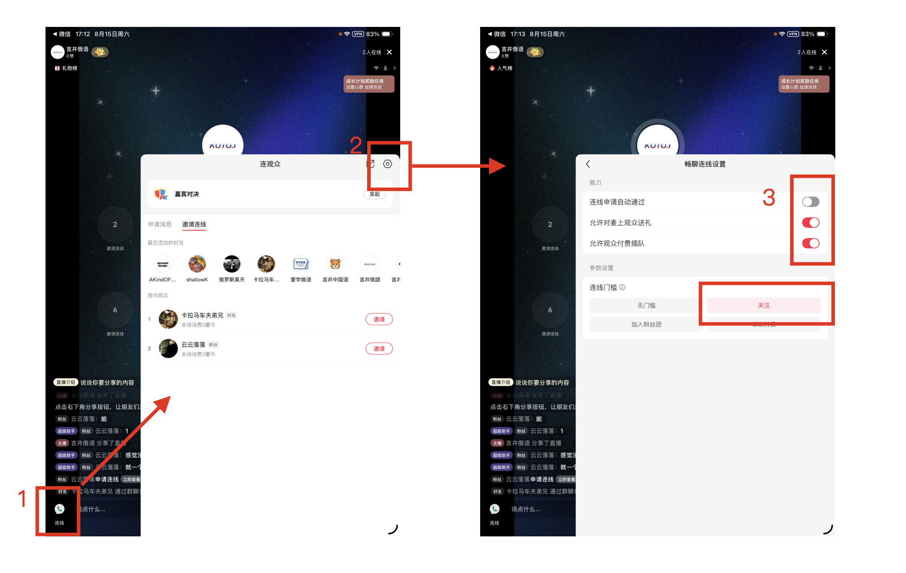
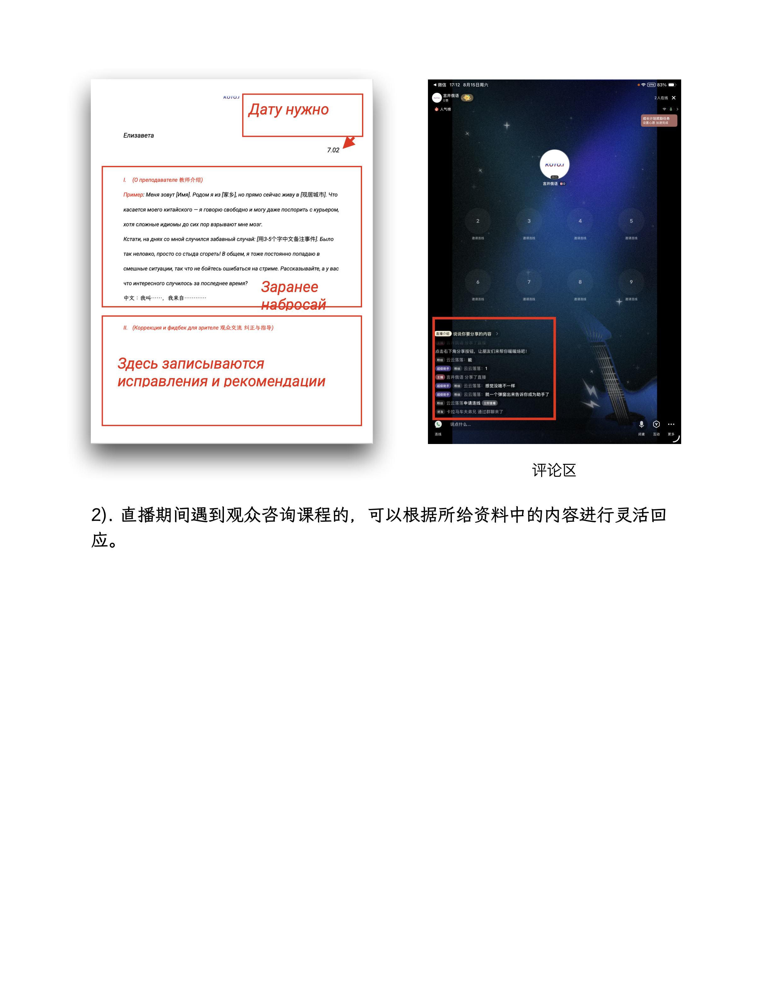

# 小红书直播准备和注意事项

## 一. 开播前

每次开播前半小时需要开始进行直播系统调试，设置内容包括直播模式、直播封面、直播标题、直播介绍（本次直播话题）。

1. **直播模式**：选择语音模式，也就是“语音”。
2. **页面布局**：选择“主次布局”。
3. **封面与标题**：需要使用我制作的直播封面和我们提供的直播间标题。

*（序号对应图片数字位置）*

---

## 二. 开播后

### 1. 设置超级助手
首先将指定账号设置为直播“超级助手”（图中所示账号仅作为展示操作流程的示范）。

---

### 2. 设置观众连线
需要设置观众申请连线**不是自动通过**，而是需要你**手动确认**，才能连线，这样可以保证一次连麦的人数，并且设置连麦的条件是**先关注才能上麦**。

*（设置后的界面如图所示）*

---

### 3. 直播流程

1. **双语自我介绍**：聊今天简单的日常（6-8min），邀请观众上麦
2. **观众 1 上麦**（5-10min）/ 口播广告
3. **话题延伸 / 评论区互动 / 邀请上麦**（5min）
4. **观众 2 上麦**（5-10min）/ 口播广告 / 邀请上麦
5. **话题延伸 / 评论区互动**（5min）
6. **观众 3 上麦**（5-10min）/ 邀请上麦
7. **观众 4 上麦**（5-10min）/ 口播广告……
8. **总结**：口播广告，表达感谢

> **口播内容举例**：如果你想练口语，可以 DM 我，我们可以现在有一对一 30 分钟口语会话的活动，一杯奶茶即可拿下。

我给的直播流程不是一个精确的流程，因为我们没法控制上麦的观众的数量和频次。所以这个结构是由固定流程——自我介绍、话题自述，然后大概从开播第 15 分钟左右开始口播广告，平均一整场直播 3-4 次口播广告，每 10-15 分钟 1 次（口播内容如上）。

然后每次到话题空档，没有人上麦的时间段时，我们先发出邀请：
> *"Есть желающие созвониться? Ничего страшного, если получается пока не очень, и если вы только начали учить — тоже ничего. Это отличный шанс попрактиковаться, мы можем говорить помедленнее."*  
> （有人想要上麦吗？说不好也没关系，刚开始学俄语也没关系，这是个练习的好机会，我们可以慢点说）

然后稍等一会儿看看有没有申请者，没有的话你可以找话聊，比如接着前一个观众的话题、回应评论区的问题或针对直播主题还有可以延展的方面你继续做表述也可以。然后你自我表述期间，关注是否有申请连麦者，有的话你马上就可以允许他上麦，你们就可以开始交流了。如果一直没有观众要上麦，你也大约维持 5 分钟邀请一次的频率就好。

我会在你和观众进行交流的时候去搜集评论区的中文互动消息，然后随时发给你，你可以在空档期间进行回应。

最后 10 分钟的时候，如果还有人正在连麦，并且申请列表还有人在排队的话，可以在结束这个人时，说明我们马上要结束了，还可以连最后一次。

以上流程我都会实时监测，并且会通过微信给你指令推进流程，因此你最好能关注实时查看我的消息（最好有两台设备，如果只有一台设备时需留意后台切换 app 查看消息时，直播间会显示“主播暂时离开”然后无法同步你的声音）。

---

## 三. 注意事项

1. **连麦互动引导**：
   直播期间与观众互动时，不要因为观众的口语水平差，觉得谈话无法推进，就让观众下播。尽可能帮助观众表达他想表达的含义，你可以猜测他想表达的内容，或是这个话题我们常用于回答的表达方式以及词汇，你介绍给观众，如图用俄语写在板书文件里展示（视频直播形式时），或评论区（语音直播形式时）。如果你不知道用中文怎么翻译给连麦观众听，你可以号召大家在评论区写下这个词的含义，直播管理员也会同时协助。

   

2. **课程咨询回应**：
   直播期间遇到观众咨询课程的，可以根据所给资料中的内容进行灵活回应。
